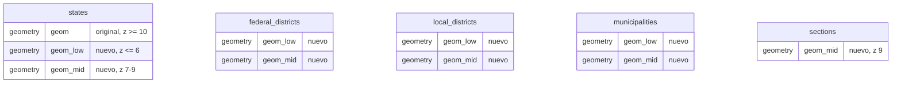

# D-80 · Teselas con geometrías generalizadas por zoom (amplía D-19)

- **Estado:** Propuesta (pendiente de aprobación; al aprobarse pasa a Aceptada)
- **Área:** Geografía electoral

## Contexto

[D-19](D-19-api-geografica.md) pide teselas MVT "con simplificación por zoom", pero el código
(`geography/service.py`, función `tile`) solo cuantiza con `ST_AsMVTGeom` sobre la geometría
original. En zoom bajo cada tesela procesa y envía los polígonos a resolución completa.

Medición del 2026-10-28 con la carga nacional en el stack de desarrollo (PostGIS directo, sin
Redis, teselas sobre CDMX):

| Tesela | Tiempo | Tamaño |
|---|---|---|
| Municipios z6 | 343–458 ms | 864–900 KB |
| Distritos locales z6 | 190–230 ms | 360 KB |
| Secciones z9 | 66–130 ms | 730–790 KB |
| Estados z4–6 | 70–150 ms | 60–100 KB |
| Secciones z11 en adelante, colonias, manzanas | 1–35 ms | ≤ 350 KB |

- Una pantalla completa en z6 (72 teselas de 3 capas) tarda 0.55–0.72 s y pesa 3.1 MB.
- En el navegador no hay fuga de memoria: el heap queda plano en ~41 MB tras 180 saltos.
- Lo que se degrada es el dibujo. Con las capas por defecto el desplazamiento cae de 60 a
  18–31 cuadros por segundo y cada salto tarda ~1 s más en cargar que solo con el mapa base.
  Se midió en Chromium sin interfaz con gráficos por software.
- El usuario con alcance restringido no es más lento: el filtro `EXISTS` es barato. El costo
  está en el volumen de vértices, no en el alcance.

## Decisión

Precalcular, al importar, versiones simplificadas de las geometrías de los niveles que se ven
en zoom bajo. El endpoint de teselas elige la versión según el zoom.

**Bandas.** La tolerancia se fija en unidades de tesela (extent 4096) al zoom máximo de la
banda: `tolerancia = k × 9784 m / 2^z_max`, convertida a grados. Con `k = 4` el error máximo es de
medio píxel en una tesela de 512 px (8 unidades por píxel), invisible al ojo.

| Columna | Se sirve en | Tolerancia con k = 4 | Niveles |
|---|---|---|---|
| `geom_low` | z ≤ 6 | ≈ 611 m (0.0055°) | estados, distritos federales, distritos locales, municipios |
| `geom_mid` | z 7–9 | ≈ 76 m (0.00069°) | los anteriores y secciones |
| `geom` (original) | z ≥ 10 | — | todos |

Colonias (z ≥ 12) y manzanas (z ≥ 14) ya son ligeras y no cambian. `k` es una constante del
código (`GENERALIZE_TOLERANCE_UNITS`). Cambiarla obliga a regenerar las columnas.

**Simplificación.** Se usa `ST_SimplifyPreserveTopology` por polígono, que siempre devuelve
geometrías válidas y no vacías. Los vecinos se simplifican por separado, así que sus fronteras
pueden diferir hasta la tolerancia. Esa diferencia queda por debajo del píxel en la banda en
que se sirve.

**Almacenamiento: opción A, columnas nuevas en las mismas tablas.**

- **Migración `0010`:** agrega las columnas, todas nullable y en SRID 4326. No agrega índices:
  la tesela sigue filtrando con el índice GiST de `geom` (`s.geom && envolvente`) y solo
  cambia la columna que envía a `ST_AsMVTGeom`.
- **Tesela:** usa `COALESCE(geom_low, geom)` o `COALESCE(geom_mid, geom)` según la banda. Un
  marco sin generalizar sigue funcionando igual que hoy.
- **Importación:** paso nuevo `_generalized_geometries` dentro de `derive`, por estado, con
  `UPDATE … WHERE … IS DISTINCT FROM` como `_electoral_regions`. Así una reimportación sin
  cambios sigue dando 0 actualizados. Los conteos van a `derived` en el reporte de la corrida.
- **Datos ya cargados:** comando `paz geo generalize [--framework NOMBRE]` para llenar las
  columnas sin reimportar.
- **Caché:** la llave de Redis pasa a `tile:v2:{marco}:…` para que no queden teselas pesadas
  hasta por una hora. Limpiar la caché al importar sigue pendiente aparte.
- **Sin cambios:** alcance (mismas filas, mismo `EXISTS`), API, OpenAPI, panel, permisos y
  bitácora (la geografía tiene `__audit__ = False`).

**Opción B, descartada a favor de A:** tabla derivada `geography.tile_geometries
(framework_id, level, node_id, band, geom)`, como `section_parts`.
- *A favor:* no ensancha las tablas y agrega bandas o niveles sin migrar cada tabla.
- *En contra:* `node_id` polimórfico sin FK, un `JOIN` extra en cada tesela para
  `is_active`, código y alcance, y un índice propio.

Con cinco niveles fijos, A es más simple y no pierde integridad.

**Otras alternativas descartadas:**
- **Pirámide de teselas precalculadas** (tabla de MVT o PMTiles): es la más rápida, pero cada
  usuario restringido ve polígonos distintos ([D-34](D-34-alcance-geografico.md)) y habría
  que generar una pirámide por alcance.
- **`ST_CoverageSimplify`**, que simplifica las fronteras compartidas una sola vez: requiere
  GEOS ≥ 3.12 y la imagen `postgres:18-bookworm` trae GEOS 3.11. Reconsiderarla si la imagen
  base pasa a trixie.
- **Simplificar al vuelo en la consulta de la tesela:** reduce el tamaño pero no el tiempo,
  porque igual procesa la geometría completa en cada petición.

## Evidencia del prototipo

Prototipo sobre tablas temporales con la carga nacional, mismas teselas de CDMX.

| Tesela | Original | k = 1 | k = 4 |
|---|---|---|---|
| Municipios z6 | 864 KB · 343 ms | 288 KB · 70 ms | 150 KB · 24 ms |
| Municipios z5 | 743 KB · 342 ms | 375 KB · 94 ms | 198 KB · 34 ms |
| Municipios z7 (`geom_mid`) | 293 KB · 116 ms | 184 KB · 63 ms | — |
| Municipios z8 (`geom_mid`) | 129 KB · 47 ms | 70 KB · 23 ms | — |
| Distritos locales z6 | 363 KB · 194 ms | 108 KB · 37 ms | — |
| Estados z4 | 67 KB · 67 ms | 41 KB · 26 ms | — |
| Secciones z9 (tolerancia de z10) | 728 KB · 66 ms | 519 KB · 64 ms | — |

**Vértices conservados.**

| Nivel | Original | Versión simplificada |
|---|---|---|
| Municipios | 2.22 M | 276 mil (k = 1, z6) · 104 mil (k = 4, z6) · 914 mil (k = 1, z9) |
| Estados | 446 mil | 52 mil (k = 1, z6) |
| Distritos locales | 1.26 M | 145 mil (k = 1, z6) |
| Secciones | 9.8 M | 4.5 M (k = 1, z10) |

Ninguna geometría quedó inválida ni vacía.

**Costo.** Generar las columnas nacionales toma unos 10 s en un solo hilo (municipios 2–2.4 s,
secciones 4 s, estados 0.4 s, distritos locales 1 s), contra ~17 min de importación. El espacio
extra estimado es de ~100 MB, el 4 % de la base.

**Límite.** En secciones z9 el peso viene de la cantidad de polígonos (miles por tesela), no de
sus vértices. La generalización solo lo baja ~30 %. Subir el zoom mínimo de secciones de 9 a
10 u 11 es una decisión de producto aparte y no forma parte de esta ADR.

## Plan (una fase)

1. Migración `0010` con las columnas y modelos actualizados (`test_models_and_migrations_do_not_drift`).
2. Paso `_generalized_geometries` en el importador y comando `paz geo generalize`.
3. Selección de columna por banda en `tile` y llave de caché `v2`.
4. Tests:
   - unitarios de la selección de banda;
   - integración con la BGD sintética: la tesela generalizada pesa menos que la original;
   - reimportar da 0 actualizados;
   - una tesela restringida contiene los mismos IDs que antes.
5. Medir de nuevo con la carga nacional (servidor y navegador) y documentar en
   `modules/geography.md`.

## Criterios de aceptación

- Municipios z6 sobre CDMX con la carga nacional: ≤ 200 KB y ≤ 50 ms sin caché.
- Pantalla completa en z6 (estados, distritos federales y municipios): ≤ 250 ms sin caché.
- La tesela de un usuario restringido contiene exactamente los mismos nodos que antes del
  cambio.
- Un marco sin columnas generalizadas sirve teselas igual que hoy.
- Reimportar el mismo estado no actualiza ninguna geometría generalizada.
- Las capturas del mapa en z6 y z9, antes y después, no muestran diferencias visibles.

*Motivo:* es el punto donde se concentra el costo medido en servidor y navegador, cumple lo que
D-19 ya prometía y no toca alcance, API ni panel. (Descartadas: opción B, pirámide de teselas,
`ST_CoverageSimplify` y simplificación al vuelo, por lo explicado arriba.)
