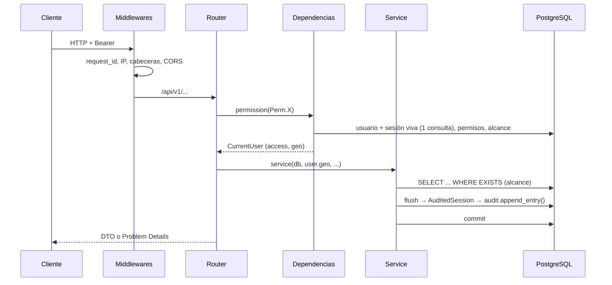

# Arquitectura de PAZOS

Este documento describe cómo está construido el núcleo en `main` después del MVP (fases A–E,
D-77) y de D-78 y D-79:

- el stack y los requisitos no funcionales, tomados del brief original
  ([`history/BRIEF_MVP.md`](history/BRIEF_MVP.md));
- el estado real de cada pieza: módulos, routers, permisos, alcance, auditoría y migraciones;
- la receta para agregar un módulo;
- las diferencias detectadas entre el código y lo que pide el brief o `CLAUDE.md`.

Las decisiones viven en [`adr/`](adr/README.md) y tienen precedencia sobre este documento.
Cada módulo tiene su ficha en [`modules/`](modules/).

## 0. Stack y requisitos no funcionales

### Stack

| Capa | Tecnología | Notas |
|---|---|---|
| Backend | Python 3.12+, FastAPI, SQLModel (SQLAlchemy 2 async + Pydantic v2), asyncpg | uv para dependencias, pydantic-settings para configuración |
| Base de datos | PostgreSQL 18 + PostGIS 3.5+ (`uuidv7()` nativo), GeoAlchemy2 | Sin el fallback a PG17: los proveedores objetivo ya ofrecen PG18 con PostGIS (riesgo resuelto en el [índice de ADR](adr/README.md#riesgos-abiertos)). Imagen propia en `infra/db` ([D-43](adr/D-43-imagen-propia-postgresql-18-postgis.md)) |
| Migraciones | Alembic | Nunca `create_all` fuera de tests |
| Importación | pyogrio | Shapefile de la BGD del INE más catálogos txt/xlsx |
| Caché y límites | Redis | Rate limiting y caché de teselas MVT. La revocación de sesiones se verifica en la BD ([D-48](adr/D-48-tokens-sesiones.md)) |
| Seguridad | pyotp (TOTP), argon2-cffi, PyJWT | Cifrado de campos con AES-256-GCM y llaves versionadas ([D-31](adr/D-31-cifrado-nivel-aplicacion.md), [D-32](adr/D-32-gestion-llaves.md)) |
| Calidad backend | ruff, mypy estricto, pytest + pytest-asyncio + testcontainers | Tests de integración contra PostGIS y Redis reales |
| Observabilidad | structlog + OpenTelemetry | |
| Panel | React 19, TypeScript 6 ([D-47](adr/D-47-typescript-6-frontend.md)), Vite, TanStack Router (SPA), Query, Form + Zod y Table | Tailwind CSS 4 + shadcn/ui; MapLibre GL para el visor |
| Cliente de API | Hey API (`@hey-api/openapi-ts`) con plugins de TanStack Query y Zod ([D-40](adr/D-40-cliente-api.md)) | Prohibido escribir `fetch` a mano |
| Calidad panel | Biome, Vitest + Testing Library, Playwright ([D-73](adr/D-73-e2e-panel-contra-stack-real.md)) | pnpm |
| Almacenamiento | S3 compatible con el SDK de MinIO (`core/storage.py`) | SeaweedFS en desarrollo y tests; Spaces o S3 en despliegue ([D-38](adr/D-38-despliegue.md), [D-94](adr/D-94-infraestructura-scheduler-s3-modulos.md)) |
| Tareas programadas | supercronic en el contenedor `scheduler`, que ejecuta comandos `paz` con candado consultivo | [D-84](adr/D-84-tareas-periodicas.md); `backend/crontab` |
| Infraestructura | Monorepo ([D-39](adr/D-39-monorepo.md)), Docker Compose (api, db, redis, s3, scheduler, frontend, caddy, mailpit), Caddy con TLS | Despliegue portátil: DigitalOcean primero, AWS probable ([D-38](adr/D-38-despliegue.md)) |
| CI | GitHub Actions | Lint, type-check, tests, E2E, contrato de API y build de imágenes, por carpeta |

### Requisitos no funcionales

| Requisito | Meta | Estado |
|---|---|---|
| Rendimiento de lectura | p95 < 200 ms con ≥ 70,000 secciones y 2.5 M de manzanas | Medido con los 32 estados cargados: lecturas ≤ 58 ms y `locate` 4.8 ms en el p95 ([FASE_C](history/fases/FASE_C.md)); búsqueda geográfica nueva entre 5 y 24 ms ([D-79](adr/D-79-busqueda-geografica-nombre-estado.md)) |
| Rendimiento de escritura | p95 < 500 ms; picos de concurrencia alta (jornada electoral) | Sin benchmark de escrituras. El candado global de la cadena de auditoría es un punto de contención (R-2 de las fases A y B) |
| Paginación | Por cursor en colecciones grandes; nada de consultas sin límite | `app.core.pagination` (`limit` ≤ 200) |
| Seguridad | OWASP ASVS nivel 2 como referencia; CORS restrictivo; cabeceras de seguridad; secretos solo por entorno o gestor; cifrado de CURP, teléfonos y direcciones a nivel aplicación | Implementado. Falta cotejar contraseñas filtradas (ASVS 2.1.7, DT-9 de la fase B) |
| Cumplimiento | LFPDPPP; preparado para aviso de privacidad, derechos ARCO y soft-delete con purga programable | Consentimientos, baja y `paz people purge` ([D-69](adr/D-69-baja-personas-suposicion-confirmar.md); el plazo de 30 días es una suposición) |
| Extensibilidad | Cada módulo futuro se agrega como un paquete sin tocar el núcleo | Parcial: ver la diferencia 2 en la §8 |
| Observabilidad | Logs JSON con `request_id`, métricas y trazas | structlog en JSON fuera de desarrollo; trazas y métricas OTel cuando hay un endpoint OTLP configurado |
| Idioma | Interfaz en es-MX; código, tablas y columnas en inglés con snake_case | Cumplido |

### Panel de administración (requisitos transversales)

| Requisito | Cómo se cumple |
|---|---|
| CRUD de todas las entidades respetando permisos y alcance | El menú y las acciones se filtran por permiso; el backend vuelve a verificar todo |
| Tablas con paginación del servidor, filtros, ordenamiento y búsqueda | `DataTable` sobre la paginación por cursor |
| Captura con teclado | `Ctrl+K`, `/`, `N`, `↑ ↓ Enter` y `Ctrl+Enter` ([D-75](adr/D-75-convenciones-panel.md)) |
| Autocompletado de geografía y personas | Ver [D-79](adr/D-79-busqueda-geografica-nombre-estado.md) |
| Validación en línea con los esquemas del backend | Zod generado ([D-75](adr/D-75-convenciones-panel.md)) |
| Sesión | Token de acceso en memoria y refresh en cookie ([D-74](adr/D-74-sesion-panel.md)) |
| Identidad visual | [D-78](adr/D-78-identidad-visual-panel.md) |

## 1. Estructura de módulos

```
backend/app/
  main.py          create_app() y build_api_router(): middlewares, errores y routers del registro
  models.py        importa los modelos de los módulos instalados (metadata para Alembic y tests)
  cli.py           CLI `paz` (Typer): users, geo, audit, keys, people, storage, openapi
  core/            infraestructura sin dominio
    config.py        Settings (pydantic-settings, prefijo PAZ_)
    db/              base.py (mixins y naming convention) · session.py (engine y SessionDep)
    audit/           hooks.py (AuditedSession) · writer.py (record_audit, append_sync)
    crypto/          FieldCipher (AES-256-GCM con sobre) · BlindIndexer (HMAC) · llaves
    errors.py        errores RFC 9457 y handlers
    pagination.py    paginación por cursor (paginate, PageParams, CursorPage)
    rate_limit.py    ventana fija en Redis
    modules.py       registro de módulos: ModuleSpec, routers, esquemas, modelos y permisos
    jobs.py          candado consultivo de las tareas programadas (exclusive_job)
    storage.py       almacenamiento S3 (ObjectStorage, StorageDep, URLs firmadas)
    middleware.py    request_id, contexto (IP, user agent) y cabeceras de seguridad
    logging.py · telemetry.py · mail.py · redis.py · health.py · context.py
  modules/
    identity/        usuarios, roles, permisos, sesiones, TOTP, alcances
      routers/ (auth, admin) · services/ (auth, mfa, sessions, credentials, admin,
      access, scopes) · security/ (tokens, passwords…) · repository.py · container.py ·
      dependencies.py · permissions.py · bootstrap.py
    geography/       marcos, niveles, búsqueda, locate, teselas MVT, importador
      models · schemas · service · router · frameworks.py · ine.py · importer/
    people/          personas con CURP validada y datos cifrados
      models · schemas · service · router · curp.py
    candidacies/     catálogos, procesos, postulaciones, fórmulas y reglas
      models · schemas · service · router · nominations.py · rules.py ·
      composition.py · scope.py
    audit/           solo router.py: lectura de la bitácora
```

**Esquemas de PostgreSQL.** Cada módulo con tablas tiene su esquema: `identity`, `geography`,
`people` y `candidacies`. Además existe `audit`, que se gestiona con SQL a mano. Los modelos
declaran `__table_args__ = {"schema": "<módulo>"}`.

**Capas.** En la práctica cada módulo tiene `models` (tablas SQLModel), `schemas` (DTOs
Pydantic de entrada y salida), `service` (lógica de negocio y consultas) y `router` (HTTP).
Solo `identity` tiene `repository.py`. En los demás módulos las consultas viven en el servicio
o en archivos de dominio (`nominations.py`, `frameworks.py`).

**Modelos base (`core/db/base.py`).**
- `BusinessTable`: PK UUIDv7 generada por PostgreSQL (`uuidv7()`) más `created_at`,
  `updated_at` y `deleted_at`.
- `ImportedMixin`: geografía, con `is_active` + `import_run_id` en lugar de soft-delete
  (D-04).
- `NAMING_CONVENTION` nombra PK, FK, UQ, IX y CK de forma explícita y determinista.

**Transacciones.** `get_session` (`SessionDep`) entrega una `AsyncSession` y solo garantiza
rollback y cierre. Quien hace commit es el servicio; en algunas rutas de `identity` lo hace el
router.

### Flujo de una petición



## 2. Registro de routers

- Cada módulo define un `APIRouter` con `prefix` y `tags`. Por ejemplo `APIRouter(prefix="/people", tags=["people"])`; `candidacies` usa un router sin prefijo con rutas como `/parties` y `/processes`.
- Cada módulo declara sus routers en `module.py` (`ModuleSpec.routers`, ver §7). `app/main.py:build_api_router()` monta los de todos los módulos instalados, en el orden de `ModuleSpec.order`, bajo `/api/v1` (`API_PREFIX`), con `responses=PROBLEM_RESPONSES` para que el OpenAPI declare los errores RFC 9457.
- `/health` y `/ready` (`core/health.py`) quedan fuera de `/api/v1` (D-46).
- Cada ruta declara un `operation_id` en camelCase y un `summary` en español. El cliente del panel se genera con esos nombres (`scripts/gen-api.sh`), y el CI falla si `frontend/openapi.json` o `frontend/src/client` están desactualizados.
- Los servicios compartidos, que dependen de configuración (tokens, cifrado, índice ciego, rate limiter, correo), se construyen una vez en el `lifespan`: `app.state.identity = build_identity_services(...)`. Se inyectan con `ServicesDep` (`identity/container.py`); `people` lo usa para obtener `cipher` e `indexer`.

## 3. Autenticación y permisos

**Autenticación (`identity/dependencies.py`).** `_authenticate`:
1. decodifica el JWT de acceso;
2. carga el usuario y la sesión en una sola consulta (sesión no revocada ni expirada, usuario activo y no borrado);
3. calcula los permisos efectivos (`load_access`) y el alcance (`resolve_scope`);
4. enlaza al actor al contexto de la petición, que usan los logs y la bitácora.

La revocación es inmediata porque se verifica en la base de datos en cada petición, sin
marcas en Redis.

**Dependencias disponibles:**

| Dependencia | Uso |
|---|---|
| `CurrentUserDep` | Cualquier usuario con token de alcance completo |
| `AnyScopeUserDep` | También acepta tokens `mfa_enrollment` (enrolar TOTP, logout, perfil) |
| `Annotated[CurrentUser, permission(Perm.X)]` | Exige el permiso `X`; responde 403 si falta |

La convención es declarar alias por módulo, por ejemplo
`Reader = Annotated[CurrentUser, permission(Perm.PERSON_READ)]`.

**Registro de permisos.**
- Cada módulo declara sus códigos en un `StrEnum` y lo referencia en `module.py`
  (`ModuleSpec.permissions`). `identity/permissions.py:Perm` reúne los de los módulos del
  núcleo. El catálogo completo es `app.core.modules.permission_codes()`. Los códigos siguen el
  formato `<módulo>.<recurso>.<acción>`.
- Cada permiso se siembra por migración: se inserta en `identity.permissions` y se asigna a
  roles en `identity.role_permissions`. Ver las migraciones 0004, 0006 y 0008, que son
  autocontenidas y no importan código de la app.
- `tests/integration/identity/test_bootstrap_and_registry.py` exige que la base y
  `permission_codes()` coincidan exactamente.
- El panel mantiene una copia manual en `frontend/src/lib/auth/permissions.ts` para ocultar
  menús y acciones (`features/shell/nav.ts`); `tests/unit/test_module_registry.py` falla si
  difiere del backend. El backend siempre vuelve a verificar.

**Reglas (D-52).**
- `roles.grants_all` (superadmin) concede todo y no tiene restricción geográfica.
- `ensure_can_assign` y `ensure_can_grant` (`services/access.py`) impiden asignar roles o
  permisos que el actor no tiene.
- TOTP es obligatorio si algún rol tiene `requires_mfa`.

Roles de sistema: `superadmin`, `admin`, `coordinator`, `capturist` y `viewer`.

## 4. Alcance geográfico (D-34)

**Modelo.**
- `identity.user_scopes` guarda los nodos asignados a cada usuario: nacional, circunscripción,
  estado, DF, DL, municipio o sección.
- `identity.user_scope_sections` es la tabla derivada con las secciones que cubren esos nodos.
  Se reconstruye en `set_scopes` y al activar un marco (`rebuild_all`). El alcance nacional no
  se materializa.
- `GeoScope.unrestricted` es verdadero para superadmin y alcance nacional.
- Sin alcance no se ve nada: se niega por defecto.

**Aplicación en la consulta.** Cada servicio recibe `user.geo` y agrega un predicado `EXISTS`
contra `user_scope_sections`. Cada predicado devuelve `None` cuando el alcance no tiene
restricción.

| Módulo | Predicado | Regla |
|---|---|---|
| Base | `GeoScope.sections_filter(col)` | La sección de `col` está en el alcance |
| Geografía | `LevelDef.visible(geo)` (`geography/service.py`) | El nodo toca al menos una sección del alcance |
| Candidaturas | `scope.readable_filter`, `is_editable`, `ensure_node_within_scope` | Se lee si comparte una sección y se edita si todas están en el alcance (vista `candidacies.nomination_sections`, migración 0009). Las postulaciones nacionales exigen alcance nacional |
| Personas | `people/service.py:visible_filter` | Domicilio en el alcance, sin domicilio, o parte de una postulación visible |
| Usuarios | `manageable_users_filter`, `ensure_within_scope` | Solo se gestiona a usuarios cuyo alcance está dentro del propio |

**Antiescalamiento.** `set_scopes` rechaza otorgar un nodo con secciones fuera del alcance
del actor; el alcance nacional solo lo otorga quien ya lo tiene.

**Rendimiento.** Después de reconstruir alcances en bloque se ejecuta
`ANALYZE identity.user_scope_sections`; sin estadísticas las teselas acotadas se degradan
([D-63](adr/D-63-operacion-geografia.md), R-7 de la [fase C](history/fases/FASE_C.md)).

## 5. Auditoría (D-37, D-45, D-53)

**Almacenamiento.**
- `audit.audit_log` es append-only, particionada por mes, con cadena de hashes calculada en
  PostgreSQL por `audit.append_entry(...)` (`SECURITY DEFINER`).
- `paz_app` solo puede ejecutar esa función y leer; los triggers rechazan UPDATE, DELETE y
  TRUNCATE.
- Operación: `paz audit verify-chain` y `paz audit ensure-partitions`, que crea las
  particiones de las dos tablas.
- **Lecturas sensibles:** `audit.access_log`, append-only y particionada igual, pero **fuera de
  la cadena** para que las lecturas no esperen el candado global ([D-89](adr/D-89-bitacora-lecturas.md)).
  Se escribe con `record_access(...)` (función `audit.record_access`, `SECURITY DEFINER`) y
  guarda quién leyó qué, nunca el contenido.
- **Consulta con alcance** ([D-93](adr/D-93-bitacora-alcance-y-enmascarado.md)):
  `GET /audit-log` y `GET /audit-log/access` muestran a un usuario con alcance limitado solo
  las entradas hechas por él o por usuarios que puede gestionar.

**Escritura automática.**
- `build_sessionmaker` usa `sync_session_class=AuditedSession`.
- El hook `after_flush` (`core/audit/hooks.py`) registra `create`, `update`, `soft_delete`,
  `restore` y `delete` de todo modelo de tabla, con `before` y `after`.
- La entrada lleva actor, IP, user agent y request_id del contexto.

**Ajustes por modelo:**
- `__audit__ = False`: no se audita. Se usa en geografía importada (una entrada `geo_import`
  por corrida, D-36), `recovery_codes`, `refresh_tokens` y `user_scope_sections`.
- `__audit_masked__`: campos guardados como `***`, como `password_hash`. Los valores `bytes`
  (cifrados e índices ciegos) siempre se enmascaran.
- `__audit_ignore_fields__`: un update que solo toca esos campos no se registra
  (`user_sessions.last_seen_at`).

**Escritura explícita.** `record_audit(db, action=..., entity_table=..., ...)` dentro de la
transacción del llamador. Se usa para eventos que no son filas: login, MFA, sesiones,
contraseñas, importaciones y activación de marcos. Para escrituras masivas con Core,
`record_bulk(...)` deja una sola entrada con los IDs afectados ([D-90](adr/D-90-auditoria-escrituras-masivas.md)).

> **Regla:** las sentencias Core (`update(...)`, `delete(...)`, `text("UPDATE …")`) **no**
> pasan por el hook. Para escrituras auditables hay que usar el ORM o llamar a
> `record_audit`. Ver las diferencias en la §8.

## 6. Migraciones

- **Alembic asíncrono.** Corre con el rol dueño (`PAZ_MIGRATIONS_DATABASE_URL`); la API usa
  `paz_app`. Nunca se usa `create_all` fuera de tests.
- **Nombres.** `file_template` produce archivos `AAAAMMDD_<rev>_<slug>.py` con revisiones
  secuenciales (`0001` … `0011`). Usa `--rev-id`:
  ```bash
  cd backend
  uv run alembic revision --autogenerate --rev-id 0012 -m "foo tables"
  uv run alembic upgrade head
  ```
- **Autogenerate (`migrations/env.py`).**
  - Ve los modelos de los módulos instalados (`app/models.py` → `import_models()`).
  - Solo compara los esquemas que declaran los módulos (`managed_schemas()`: `identity`, `geography`, `people`,
    `candidacies`).
  - Ignora `audit` y las particiones de manzanas que se crean en tiempo de ejecución.
  - Compara tipos y server defaults; corre una transacción por migración.
- **Privilegios.**
  - La migración 0001 crea los esquemas, les quita `PUBLIC` y aplica
    `ALTER DEFAULT PRIVILEGES` para que `paz_app` reciba SELECT, INSERT, UPDATE y DELETE en
    toda tabla nueva de esos esquemas.
  - Por eso una tabla nueva en un esquema existente no necesita GRANT, pero un esquema nuevo
    sí.
  - Los GRANT van envueltos en `if_role_exists(app_role(), ...)` (`migrations/helpers.py`)
    para que una base sin el rol también migre.
  - Las vistas y funciones se crean con SQL a mano; para scripts con varias sentencias se usa
    `execute_script`.
- **Semillas.** Los datos de referencia van en migraciones autocontenidas con SQL explícito,
  sin importar código de la app: roles, permisos, cargos, reglas y el partido PAZ.
- **Tests.** `tests/integration/test_migrations.py` baja hasta `base`, vuelve a `head` y
  verifica que haya una sola cabeza. Los fixtures de integración migran una base real de
  PostGIS 18 con testcontainers.

## 7. Receta: agregar un módulo nuevo

El ejemplo usa el módulo `foo` y el recurso `item`. Cada paso indica dónde se toca el código.

1. **Paquete** `backend/app/modules/foo/`: `__init__.py`, `module.py`, `models.py`,
   `schemas.py`, `service.py`, `router.py` y `permissions.py` (más `scope.py` si sus reglas de
   alcance no son triviales). `module.py` registra el módulo; no se edita ningún archivo del
   núcleo:
   ```python
   from app.core.modules import ModuleSpec

   MODULE = ModuleSpec(
       name="foo",
       order=60,                                   # orden de los routers y de OpenAPI
       schema="foo",                               # esquema que gestiona autogenerate
       models="app.modules.foo.models",
       routers=("app.modules.foo.router:router",),
       permissions="app.modules.foo.permissions:FooPerm",
   )
   ```
2. **Modelos.** Heredan de `BusinessTable` (o `ImportedMixin` si es geografía importada), con
   `__tablename__` en plural snake_case y `__table_args__ = {"schema": "foo"}`.
   - Declara `__audit_masked__` o `__audit_ignore_fields__` si aplica.
   - Para referencias geográficas, guarda `section_id`: el alcance se resuelve por sección.
   - Para datos sensibles, usa `FieldCipher` más `BlindIndexer` a través de `ServicesDep`,
     como en `people`.
3. **Modelos:** ya quedan registrados por `ModuleSpec.models`.
4. **Permisos.**
   - Declara los códigos en `app/modules/foo/permissions.py` (`class FooPerm(StrEnum)`:
     `foo.item.read`, `foo.item.write`…).
   - Cópialos en `frontend/src/lib/auth/permissions.ts`; el test del registro falla si no.
5. **Migración del esquema** (a mano, `--rev-id` siguiente):
   ```python
   from migrations.helpers import app_role, if_role_exists

   def upgrade() -> None:
       op.execute("CREATE SCHEMA IF NOT EXISTS foo")
       op.execute("REVOKE ALL ON SCHEMA foo FROM PUBLIC")
       role = app_role()
       op.execute(if_role_exists(role, f"""
           GRANT USAGE ON SCHEMA foo TO {role};
           ALTER DEFAULT PRIVILEGES IN SCHEMA foo
             GRANT SELECT, INSERT, UPDATE, DELETE ON TABLES TO {role};
           ALTER DEFAULT PRIVILEGES IN SCHEMA foo
             GRANT USAGE, SELECT ON SEQUENCES TO {role};
       """))
   ```
   Con un `downgrade` simétrico.
6. **Tablas:** el esquema ya está en `managed_schemas()` por `ModuleSpec.schema`. Genera las
   tablas con `alembic revision --autogenerate --rev-id …` y revisa el resultado: nombres de
   índices, CHECKs e índices GiST o trigram.
7. **Migración de semilla** de permisos y su asignación a roles, siguiendo el patrón de
   `0008_candidacies_seed.py` (listas `PERMISSIONS` y `GRANTS`, con downgrade que borra por
   código). El test del registro falla si se olvida.
8. **Servicio.**
   - Recibe `db`, `user.geo` y los DTOs.
   - Toda consulta de lista o detalle aplica el predicado de alcance
     (`geo.sections_filter(col(Foo.section_id))` o uno propio) y excluye `deleted_at`.
   - Las listas usan `app.core.pagination.paginate` con una lista permitida de `sort`.
   - Las escrituras se hacen con el ORM, para que queden auditadas; si usas Core, llama a
     `record_audit`.
   - Los errores se levantan con las clases de `app.core.errors`; los de reglas de negocio
     responden 409 con un `code` propio.
9. **Router.** `APIRouter(prefix="/foo", tags=["foo"])`, con alias
   `Reader = Annotated[CurrentUser, permission(Perm.FOO_ITEM_READ)]`, `operation_id` en
   camelCase y `summary` en español. Se monta solo por `ModuleSpec.routers`.
10. **Tests.**
    - Unitarios en `tests/unit`.
    - De integración en `tests/integration/foo/`, contra la API real, con al menos:
      - un usuario sin el permiso recibe 403;
      - un usuario con alcance estatal **no** ve ni edita registros de otro estado;
      - las escrituras aparecen en `audit.audit_log`.
    - La cobertura de servicios debe ser ≥ 85 %.
11. **Contrato y panel.**
    - Regenera el contrato y el cliente con `./scripts/gen-api.sh`.
    - Agrega las rutas en `frontend/src/routes/_app/foo/` y la lógica de pantalla en
      `src/features/foo/`.
    - Registra la entrada del menú en `src/features/shell/nav.ts` con su `perm`.
    - Agrega un escenario E2E si el flujo es crítico.
12. **Documentación.**
    - La ficha del módulo en `docs/modules/foo.md`, a partir de `_TEMPLATE.md`; conviene escribirla antes del código.
    - Cada decisión nueva como `docs/adr/D-NN-tema.md`, agregada al índice.
    - La sección del módulo en el `README`.
    - La colección Bruno en `docs/api/foo/`.
    - Las variables nuevas en `.env.example`.

## 8. Diferencias entre el código y los requisitos

La tabla ordena las diferencias de mayor a menor relevancia. "Decisión" indica si
alguna ADR ya la cubre. Los requisitos vienen del brief original, hoy repartido entre `CLAUDE.md`, la §0 y las fichas.

| # | El requisito dice | El código hace | Decisión |
|---|---|---|---|
| 1 | Bitácora "para toda escritura del sistema" | Resuelta: las cuatro escrituras Core que se saltaban el hook pasaron al ORM (ver abajo) | Sí, [D-93](adr/D-93-bitacora-alcance-y-enmascarado.md) |
| 2 | "Cada módulo futuro se agrega como un paquete nuevo sin tocar el núcleo" | Resuelta: cada módulo se registra con su `module.py` (routers, esquema, modelos y permisos). Solo queda la copia de permisos del panel, ahora verificada por un test | Sí, [D-94](adr/D-94-infraestructura-scheduler-s3-modulos.md) |
| 3 | Bitácora consultable con alcance geográfico implícito (el rol `admin` es "dentro de su alcance") | Resuelta: un usuario con alcance limitado solo ve las entradas suyas y de los usuarios que puede gestionar | Sí, [D-93](adr/D-93-bitacora-alcance-y-enmascarado.md) |
| 4 | Cada módulo con `models, schemas, repository, service, router`; D-34: "filtro en la capa de repositorio" | Solo `identity` tiene `repository.py`. En los demás, las consultas y los filtros de alcance viven en `service.py` y archivos de dominio. El filtro sí está en la consulta SQL, que es lo que importa | Parcial (D-34 habla de repositorio) |
| 5 | "Los routers solo orquestan" | Hay lógica en algunos routers: `geography/router.py` consulta marcos directo y maneja la caché de teselas en Redis; `people/router.py` descifra y enmascara la CURP y los contactos; algunas rutas de `identity` hacen `commit` | No |
| 6 | Redis "para caché, rate limiting y sesiones revocadas" | Redis se usa para rate limiting y caché de teselas MVT (solo usuarios sin restricción). La revocación se verifica en BD en cada petición | Sí (fase B, "Revocación inmediata") |
| 7 | `app/core (config, seguridad, db, auditoría)` | La seguridad de identidad (JWT, Argon2, TOTP) vive en `identity/security`; `core` tiene `crypto` (cifrado de campos), rate limit y middlewares | No (organización) |
| 8 | PK UUIDv7 con `created_at`, `updated_at` y `deleted_at` en todas las tablas, salvo D-03, D-04 y D-37 | `identity.user_scope_sections` usa PK compuesta `(user_id, section_id)` sin timestamps. Es una tabla derivada, en la línea de D-03, pero no está listada como excepción | Parcial |
| 9 | WebAuthn/passkeys "preparado como extensión" | No hay código específico; `user_sessions.auth_methods` (RFC 8176) admite nuevos métodos y `reference/data-model.md` prevé una tabla `webauthn_credentials` futura | Sí (data-model.md) |
| 10 | Valores sensibles de la bitácora "enmascarados o cifrados" (D-37) y purga ARCO de personas (D-69) | Resuelta: `Person` enmascara nombre, apellidos, nacimiento, sexo y entidad, y `PersonAddress` el CP. La geografía del domicilio se conserva | Sí, [D-93](adr/D-93-bitacora-alcance-y-enmascarado.md) |
| 11 | D-19: teselas MVT "con simplificación por zoom" | Resuelta: hasta D-80 `tile` solo cuantizaba la geometría original (~900 KB y ~350 ms por tesela de municipios en z6). Ahora sirve `geom_low` / `geom_mid` según el zoom (188 KB, 24–58 ms) | Sí, [D-80](adr/D-80-teselas-geometrias-generalizadas.md) |

**Detalle de la diferencia 1 (resuelta).** Las escrituras que se saltaban el hook eran:

| Ubicación | Ahora |
|---|---|
| `identity/services/scopes.py` (`set_scopes`) | Borra los `user_scopes` anteriores con el ORM; queda qué alcance se quitó |
| `people/service.py` (`update_person`) | Retira contactos y domicilios con el ORM (`soft_delete`) |
| `people/service.py` (`purge_due`) | Borra contactos, domicilios y consentimientos con el ORM (`delete`) |
| `candidacies/nominations.py` (`update_members`) | Retira a los integrantes anteriores con el ORM (`soft_delete`) |

Las escrituras Core sobre `recovery_codes`, `refresh_tokens` y `user_scope_sections` siguen
excluidas a propósito (D-53, D-34).

**Detalles menores** (resueltos en la fase 0b): el docstring de `identity/permissions.py`
apunta al test real; los módulos pueden declarar sus permisos en su propio `StrEnum`, y la
copia del panel tiene test (`tests/unit/test_module_registry.py`).
