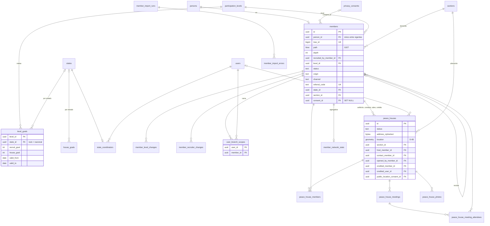
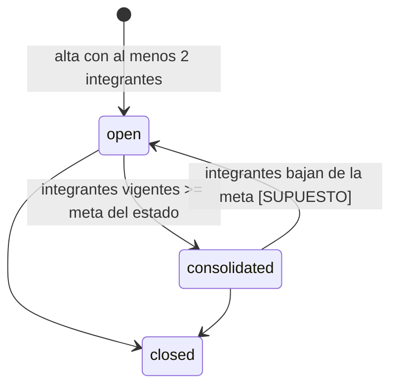

# Módulo: Movimiento de Paz

**Estado:** especificación aprobada para diseño; sin implementar.
**Paquete propuesto:** `backend/app/modules/peace_movement` · esquema `peace_movement` · API
`/api/v1/peace-movement`.
**Brief:** respuestas de Darío del 2026-10-29. Lo marcado como **[SUPUESTO]** no fue dicho
explícitamente y debe confirmarse; lo marcado como **[ADR]** requiere proponer una decisión
con alternativas antes de implementarse. Las decisiones propuestas son D-82 a D-91
([índice](../adr/README.md#movimiento-de-paz-propuestas)).

## Propósito y usuarios

El Movimiento de Paz (MP) es la red de simpatizantes del partido. Funciona como una
**pirámide de reclutamiento**: cada integrante (pacificador) se compromete a reclutar un número
de personas según el nivel que elige, y se organiza en **Casas de Paz**, puntos de encuentro
georreferenciados.

El módulo resuelve tres cosas:
1. Registrar quién se inscribe, quién lo reclutó y con qué compromiso.
2. Registrar y dar seguimiento a las Casas de Paz hasta su consolidación.
3. Medir el avance contra metas y el crecimiento de la red, por rama y por geografía.

| Usuario | Qué hace | Versión |
|---|---|---|
| `admin` | Configura niveles y metas por estado; todo lo de coordinator | Esta |
| `coordinator` | Valida inscripciones, reasigna reclutadores, importa listas, gestiona casas, consulta estadísticas | Esta |
| `capturist` | Inscribe pacificadores y registra casas, integrantes y reuniones | Esta |
| `viewer` | Consulta | Esta |
| Persona sin cuenta | Se inscribe con el enlace o QR de un pacificador; queda pendiente de validar | Esta |
| Pacificador con cuenta | Portal propio: inscribe y ve su red | **Posterior** (requisitos abajo) |
| Brigadista en campo | App Flutter con captura sin conexión | **Posterior** (requisitos abajo; el backend deja la API) |

No se crean roles nuevos: los roles existentes reciben permisos `peace_movement.*`.

## Dependencias

| Módulo | Qué usa (no se redefine aquí) |
|---|---|
| `people` | `persons` (CURP, nombre, sexo, nacimiento), `person_contacts`, `person_addresses` (domicilio principal) y `privacy_consents`. Un pacificador **es** una persona |
| `geography` | Marco activo, secciones y niveles superiores para domicilio, ubicación de casas y estadísticas por geografía |
| `identity` | `CurrentUser`, `Perm`, `GeoScope` y `user_scope_sections`. El alcance por rama se propone dentro de este módulo, sin tocar `identity` ([D-83](../adr/D-83-alcance-por-rama.md)) |
| `core` | `BusinessTable`, `AuditedSession`, `record_audit`, `paginate`, errores RFC 9457, `FieldCipher`, rate limiting y el almacenamiento de archivos de la fase 0 |

### Cambios a módulos existentes (requieren propuesta antes de implementar)

1. **`people.privacy_consents`:** distinguir el aviso del MP del aviso general, ampliar los
   canales (`referral_link`, `import`, `field_app`; hoy el CHECK solo admite `panel`, `paper` y
   `web`) y guardar la huella del texto aceptado. **[ADR]** [D-82](../adr/D-82-consentimiento-aviso-movimiento-paz.md)
2. **Alcance por rama** (`user_branch_scopes`), ver «Permisos y alcance». Amplía D-34 y D-66:
   `people/service.py:visible_filter` y `_ensure_address_in_scope` solo conocen la geografía.
   **[ADR]** [D-83](../adr/D-83-alcance-por-rama.md)
3. **`people`, baja ARCO (D-69):** `delete_person` debe marcar `withdrawn` al pacificador, y
   `purge_due`, que borra consentimientos y domicilios, no debe romper el nodo (FKs con
   `SET NULL`, nunca `CASCADE` hacia `members`).
4. **`core`:** almacenamiento de archivos compatible con S3 (fotos de casas), según D-38. Se construye en la fase 0.
5. **`core`:** ejecución de tareas periódicas o en segundo plano para los agregados. Hoy solo hay
   comandos de CLI y ningún contenedor que los programe. **[ADR]** [D-84](../adr/D-84-tareas-periodicas.md)
6. **Bitácora:** lecturas sensibles fuera de la cadena global ([D-89](../adr/D-89-bitacora-lecturas.md))
   y escrituras masivas por lote ([D-90](../adr/D-90-auditoria-escrituras-masivas.md)). **[ADR]**
7. **Base de datos:** extensión `ltree`, no instalada hoy. **[ADR]** [D-91](../adr/D-91-jerarquia-reclutamiento-ltree.md)

## Entidades y relaciones

### Catálogos y configuración

| Tabla | Campos clave | Notas |
|---|---|---|
| `participation_levels` | `code`, `name`, `rank`, `sort_order` | Sembrados: `pacifier` (Pacificador), `peace_promoter` (Promotor de la Paz), `peace_messenger` (Mensajero de Paz), `peace_builder` (Constructor de Paz), `peace_ambassador` (Embajador de Paz), de menor a mayor `rank` |
| `level_goals` | `level_id`, `state_id` (nulo = valor nacional por defecto), `recruit_goal`, `house_goal`, `valid_from`, `valid_to` | Metas ajustables **por estado** con historial. Semillas nacionales: 1, 10, 50, 100 y 500 reclutas; 5 casas para Embajador |
| `house_goals` | `state_id` (nulo = nacional), `member_goal`, `valid_from`, `valid_to` | Meta de integrantes por casa, ajustable por estado. Semilla nacional: 100 |
| `state_coordinators` | `state_id`, `user_id` | Usuario del sistema que recibe el crédito de casas sin Embajador en su red. **[SUPUESTO]** uno por estado |

El avance siempre se mide contra la meta **vigente** del estado del pacificador o de la casa.
Cambiar una meta no reescribe el pasado: queda en el historial (`valid_from`, `valid_to`).
Dos metas vigentes no pueden empalmarse para el mismo nivel y estado (incluido el nacional, con
`state_id` nulo): restricción `EXCLUDE` sobre el rango de vigencia.

### Pacificadores

`members`: la capa del MP sobre una persona.

| Campo | Descripción |
|---|---|
| `person_id` | FK a `people.persons`; único entre registros vigentes. La persona **debe tener CURP** y **domicilio principal** |
| `enrolled_on` | Fecha de inscripción al MP |
| `level_id` | Nivel elegido como compromiso. No sube solo al cumplir la meta |
| `recruited_by_member_id` | Integrante del MP que lo inscribió. Nulo solo si `origin` no es `recruiter` |
| `origin` | `recruiter` · `structure` · `event` · `campaign`, más `origin_detail` (texto o referencia al evento) |
| `registered_by_user_id` | Usuario que hizo la operación. Nulo en inscripciones públicas por enlace |
| `channel` | `panel` · `referral_link` · `import` · `field_app` |
| `status` | `pending_validation` · `active` · `rejected` · `left` (dejó el MP; la persona sigue en `people`) · `withdrawn` (baja ARCO de la persona, D-69) |
| `validated_by_user_id`, `validated_at` | Quién validó y cuándo |
| `referral_code` | Código único y no adivinable para su enlace y QR personal |
| `tree_id` | Entero interno (bigint de secuencia) usado como etiqueta en la ruta; la PK sigue siendo UUIDv7 (D-91) |
| `path` | `ltree` con la cadena de `tree_id` desde la raíz hasta el nodo; índice GiST |
| `depth` | Profundidad en la pirámide |
| `state_id`, `section_id` | Derivados del domicilio principal; definen la meta aplicable y el alcance geográfico. Se actualizan si cambia el domicilio |
| `consent_id` | Consentimiento del aviso del MP. Nulable con `ON DELETE SET NULL`: la purga de D-69 borra los consentimientos y el nodo se conserva |

**Historiales:**
- `member_level_changes`: `member_id`, `from_level_id`, `to_level_id`, `changed_by_user_id`, `changed_at`, `reason`. Se puede subir o bajar.
- `member_recruiter_changes`: `member_id`, `from_member_id`, `to_member_id`, `changed_by_user_id`, `reason`, `changed_at`.

### Casas de Paz

`peace_houses`:

| Campo | Descripción |
|---|---|
| `name`, `schedule` (JSON con días y horas), `capacity` | Datos de la casa |
| `address_ciphertext` | Calle, números y referencias cifrados, como en `people` |
| `location` | Punto georreferenciado (SRID 4326), más `section_id` y FKs de geografía derivadas. Su precisión depende de [D-85](../adr/D-85-ubicacion-casas-paz.md) (propuesta: exacto dentro del cifrado, aproximado a ~100 m en claro) |
| `host_member_id` | Anfitrión; debe ser pacificador. El domicilio de la casa puede ser distinto al suyo |
| `contact_member_id` | Un solo contacto responsable; debe ser pacificador. Puede coincidir con el anfitrión |
| `opened_by_member_id` | Pacificador que la abrió (cualquier nivel) |
| `credited_member_id` / `credited_user_id` | A quién se acredita la casa (exactamente uno, ver reglas) |
| `status` | `open` (abierta) · `consolidated` (alcanzó la meta) · `closed` |
| `opened_on`, `consolidated_on`, `closed_on` | Fechas de cada estatus |
| `public_location_consent_id` | Consentimiento expreso del anfitrión para publicar la ubicación exacta. Nulo = la casa no es publicable |

**Relacionadas:**
- `peace_house_members`: `house_id`, `member_id`, `joined_on`, `left_on`, `source` (`enrollment` o `assignment`). Un pacificador puede integrar **varias** casas.
- `peace_house_meetings`: `house_id`, `held_at`, `topic`, `notes`; con `peace_house_meeting_attendees` (`meeting_id`, `member_id`). Si se registran invitados (pregunta abierta 6), la columna sería `person_id`: `people` ya admite personas sin CURP ni domicilio.
- `peace_house_photos`: `house_id`, referencia al archivo del almacenamiento de la fase 0, `caption`.

### Estadísticas e importación

- `member_network_stats`: por pacificador, `direct_active`, `direct_pending`, `network_total`,
  conteo por nivel en toda la red, `houses_open`, `houses_consolidated` y `computed_at`.
- `enrollment_daily_counts`: inscripciones por día, nivel y sección, para crecimiento en el tiempo
  y cruces por geografía (los niveles superiores se suman desde la sección).
- `network_changes`: bitácora de cambios pendientes de agregar (alta, validación, baja, reasignación,
  cambio de nivel, alta o baja en casa). La consume el proceso de agregados.
- `member_import_runs` y `member_import_errors`: corridas de importación con reporte por fila,
  siguiendo el patrón del importador de geografía.

### Diagrama entidad-relación

Las tablas de `people`, `geography` e `identity` solo se referencian.

`network_changes` y `enrollment_daily_counts` no tienen FKs: son tablas de salida y de agregados.

### Ciclo de vida

```mermaid
stateDiagram-v2
  [*] --> pending_validation: enlace, importación, app de campo
  [*] --> active: panel (capturista)
  pending_validation --> active: coordinator valida
  pending_validation --> rejected: coordinator rechaza
  active --> left: deja el MP (coordinator, con motivo)
  active --> withdrawn: baja ARCO de la persona (D-69; anonimizada al vencer la retención)
  left --> withdrawn: baja ARCO de la persona
```

## Reglas de negocio

### Inscripción
- Toda persona inscrita al MP tiene un nivel; el mínimo es Pacificador.
- **CURP obligatoria** y validada con las reglas de `people`. La unicidad es por CURP (una
  persona) y por persona (un registro vigente del MP).
- **Domicilio principal obligatorio**: define el estado de su meta y su alcance geográfico.
- Se exige el consentimiento del aviso de privacidad del MP, con versión y canal. La afiliación
  a un movimiento político es un dato personal sensible (LFPDPPP); **el formato y la forma de
  recabar el consentimiento expreso deben validarse con el área jurídica**.
- Se permiten inscripciones **sin reclutador** solo con `origin` = `structure`, `event` o
  `campaign`; esas son las raíces de la pirámide.
- Desde el panel, la inscripción de un capturista queda `active`. Por enlace, importación o app
  de campo queda `pending_validation` y no cuenta para metas ni estadísticas de avance hasta validarse.
  **[SUPUESTO]** las importaciones hechas por un coordinator también entran pendientes.
- El reclutador debe estar `active` al momento de la inscripción. **[SUPUESTO]**
- Si la CURP ya existe en `people`, se reutiliza la persona y los datos capturados **no**
  sobrescriben los suyos. En una inscripción pública las diferencias quedan como notas para la
  validación (no se revela que la persona existía).
- Una inscripción `rejected` que creó una persona nueva da de baja a esa persona por el flujo
  de D-69, salvo que ya tuviera otro uso (postulación u otro registro). **[SUPUESTO]**
- Un usuario con alcance por rama puede inscribir a un recluta con domicilio fuera de su alcance
  geográfico si el reclutador está en su rama: es una excepción explícita a D-66 ([D-83](../adr/D-83-alcance-por-rama.md)).

### Niveles y metas
- El nivel lo elige la persona como compromiso. Puede **subir o bajar** después; cada cambio queda en `member_level_changes`.
- **Avance contra meta** = reclutas **directos** `active` frente a `recruit_goal` del nivel
  vigente en su estado. La red total se reporta aparte y no cuenta para la meta.
- El Embajador tiene además meta de casas (`house_goal`), medida con casas **consolidadas** a su crédito; las abiertas se reportan aparte.
- Las metas son **acumuladas** desde la inscripción (no se reinician por periodo).
- **[SUPUESTO]** semáforo de avance configurable: rojo < 50 %, amarillo 50–99 %, verde ≥ 100 %.

### Reasignación de reclutador
- Solo `coordinator` o `admin`, con motivo obligatorio; queda en `member_recruiter_changes`.
- No puede apuntar a un descendiente del propio nodo (evita ciclos) ni a sí mismo.
- Reescribe `path` y `depth` de todo el subárbol en la misma transacción y registra en `network_changes` las dos cadenas de ancestros afectadas.
- La reescritura masiva de rutas usa SQL Core: se registra con `record_audit` como una sola
  entrada por reasignación (D-45; propuesta en [D-90](../adr/D-90-auditoria-escrituras-masivas.md)).

### Salida del MP y baja (ARCO)
Son dos cosas distintas:
- **Salida del MP** (`left`): la persona deja el movimiento pero sigue en `people` (por ejemplo,
  porque es candidata). La registra un coordinator con motivo; el nodo se conserva.
- **Baja ARCO** (`withdrawn`): sigue el flujo de `people` ([D-69](../adr/D-69-baja-personas-suposicion-confirmar.md)).
  `DELETE /people/{id}` marca al pacificador `withdrawn` en la misma transacción. Durante la
  retención (30 días, suposición de D-69) la persona queda con soft-delete; al vencer,
  `paz people purge` la anonimiza y borra contactos, domicilios y consentimientos.
  - Hoy `delete_person` rechaza la baja de quien integra una fórmula vigente. Esa regla aplica
    igual a un pacificador candidato.
  - El nodo se **conserva**: sus reclutas no cambian de reclutador y las estadísticas de la red
    se mantienen. `state_id` y `section_id` del nodo se conservan para los agregados.
    **[SUPUESTO]**: confirmar con jurídico que la sección de una persona anonimizada no es un
    dato a borrar.
- Un nodo `left` o `withdrawn` no puede reclutar ni ser contacto o anfitrión. Si era contacto o
  anfitrión de una casa, la casa queda marcada para reasignarlos. **[SUPUESTO]**

### Casas de Paz
- Se pueden abrir con **al menos 2 integrantes** vigentes. **[SUPUESTO]** el anfitrión y el contacto cuentan como integrantes si se agregan como tales.
- Pasa a `consolidated` cuando sus integrantes vigentes alcanzan `member_goal` del estado de la
  casa (100 por defecto). Se da seguimiento al avance hacia esa meta.
- Un pacificador entra a una casa de dos formas: indicándola al inscribirse (`source = enrollment`) o por asignación posterior (`assignment`).
- Cualquier pacificador puede abrir una casa. **Crédito:**
  1. se busca, desde quien la abre y hacia arriba en su `path` (incluido él mismo), el primer Embajador `active`;
  2. si no hay ninguno, se acredita al usuario de `state_coordinators` del estado de la casa.

  **[SUPUESTO]** el crédito se fija al abrir la casa y solo un coordinator puede reasignarlo; no se recalcula si después alguien asciende.
- La ubicación exacta solo es publicable con el consentimiento expreso del anfitrión. El mapa público es una entrega posterior; esta versión solo guarda el consentimiento.

## Permisos y alcance

| Permiso | Uso | Roles |
|---|---|---|
| `peace_movement.member.read` | Buscar y ver pacificadores y su red | admin, coordinator, capturist, viewer |
| `peace_movement.member.write` | Inscribir, editar, cambiar nivel | admin, coordinator, capturist |
| `peace_movement.member.validate` | Validar o rechazar inscripciones pendientes | admin, coordinator |
| `peace_movement.member.reassign` | Cambiar reclutador | admin, coordinator |
| `peace_movement.member.import` | Importación masiva | admin, coordinator |
| `peace_movement.house.read` | Ver casas, integrantes, reuniones y fotos | admin, coordinator, capturist, viewer |
| `peace_movement.house.write` | Abrir, editar y cerrar casas; integrantes, reuniones y fotos | admin, coordinator, capturist |
| `peace_movement.house.reassign_credit` | Reasignar el crédito de una casa | admin, coordinator |
| `peace_movement.stats.read` | Estadísticas y reportes | admin, coordinator, viewer |
| `peace_movement.goal.manage` | Niveles, metas por estado y coordinadores estatales | admin |

Los datos de contacto y domicilio se siguen rigiendo por `people.person.read_sensitive`.

### Alcance
Un usuario ve un pacificador si se cumple **cualquiera** de estas condiciones:
1. **Geográfico:** la sección de su domicilio está en el alcance del usuario (`user_scope_sections`).
2. **Por rama (nuevo):** el pacificador está dentro de la red de algún nodo asignado al usuario
   en `user_branch_scopes` (`path <@ rama.path`), aunque cruce estados.

Reglas:
- Una casa es visible si su sección está en el alcance o su anfitrión, contacto o quien la abrió es visible.
- Fuera del alcance, la red de un pacificador visible se muestra **solo en totales**, sin nombres ni datos.
- **Antiescalamiento:** solo se otorga la rama del nodo X si el actor no tiene restricción o si
  X está dentro de una rama que ya tiene (`X.path <@ rama_del_actor.path`). Ver X por su
  domicilio **no** basta: su subárbol puede cruzar a estados que el actor no ve.
- **Datos personales:** el MP sirve los de sus pacificadores en sus propios endpoints, con este
  alcance y el enmascarado de D-66. `/people` sigue rigiéndose solo por la geografía.
- **Dónde vive:** `peace_movement.user_branch_scopes`, resuelto por una dependencia del módulo
  ([D-83](../adr/D-83-alcance-por-rama.md), opción recomendada).
- Las estadísticas por geografía se filtran por el alcance geográfico; las de rama, por el alcance por rama.

## Datos sensibles

- La pertenencia al MP es en sí un dato sensible. Todo lo que liga a una persona con el MP
  (`members`, integrantes de casas, asistentes a reuniones) se trata como tal.
- Contactos y domicilio de la persona: cifrados en `people`, sin cambios.
- Domicilio de la casa: `address_ciphertext` cifrado. El punto `location` queda en claro porque
  lo requieren las consultas geográficas. **[ADR]** [D-85](../adr/D-85-ubicacion-casas-paz.md):
  precisión reducida en claro y punto exacto cifrado.
- **Auditoría de lecturas:** consultar el detalle de un pacificador, su red o una exportación
  genera entrada en la bitácora (depende de la fase 0). **[ADR]** [D-89](../adr/D-89-bitacora-lecturas.md):
  una tabla aparte, sin el candado global de la cadena (D-45).
- **Bitácora:** lo que una baja ARCO debe borrar son los datos de la persona (nombre, CURP,
  contactos), que viven en `people`; por eso la fase 0 resuelve la diferencia 10
  (`Person` sin `__audit_masked__`). En `members` el enmascarado es secundario: su fila liga a
  un `person_id` que queda anonimizado.
- La inscripción pública no debe revelar si una CURP ya está registrada: responde igual en ambos
  casos y el duplicado se resuelve en la validación.
- `referral_code` no debe ser secuencial ni derivable del ID.

## Volumen y rendimiento

- **Volumen:** cientos de miles de pacificadores en 2 a 3 años; diseñar y medir con 1 millón.
- **Profundidad:** desconocida. Se registra y monitorea `depth`, sin límite duro. **[SUPUESTO]** alerta operativa si un nodo supera 50 niveles.

### Cómo se evita la recursión infinita
1. **Sin ciclos por construcción:** el reclutador existe antes que el reclutado y la reasignación rechaza descendientes.
2. **Sin CTE recursivo en lecturas:** subárbol y ancestros se resuelven con `ltree` y GiST (`path <@`, `path @>`).
3. **Estadísticas precalculadas:** ninguna pantalla cuenta la red al vuelo. `member_network_stats`
   se actualiza de forma asíncrona cada pocos minutos desde `network_changes`, con recálculo
   completo nocturno que corrige desviaciones.
4. **Sin contención en la cima:** las altas no actualizan en línea los contadores de sus ancestros;
   el proceso de agregados aplica los cambios por lotes.
5. **Lecturas acotadas:** la API de red devuelve agregados más hijos directos paginados, con
   `max_depth` acotado (por defecto 1, máximo 3) para profundizar bajo demanda. Nunca devuelve una red completa.

### Metas de rendimiento
- Inscripción desde el panel: p95 < 500 ms.
- Detalle de un nodo con sus agregados e hijos directos: p95 < 200 ms con 1 millón de pacificadores.
- Las estadísticas reflejan una inscripción en menos de 5 minutos.
- Reasignar un subárbol de 10,000 nodos: < 10 s.
- Importación: 50,000 filas en menos de 5 minutos, con reporte de errores.

## Integraciones y eventos

**Consume:**
- `people`: alta o reutilización de la persona; consentimiento; flujo de baja ARCO.
- `geography`: validación del domicilio y de la ubicación de la casa; niveles para los cruces.
- `identity`: usuarios, alcances geográficos y por rama.

**Expone para entregas posteriores:**
- **Inscripción pública** por enlace o QR (esta versión): endpoint sin autenticación con
  `referral_code`, rate limiting por IP y protección contra bots **[ADR]** ([D-86](../adr/D-86-proteccion-bots-inscripcion-publica.md)), aceptación del aviso
  y alta en `pending_validation`. Página pública en el frontend fuera del layout autenticado.
- **Carga por lotes idempotente** (esta versión, para la app de campo): cada inscripción trae un
  UUID generado por el cliente; reenviar el mismo lote no duplica. Respuesta con el resultado por elemento.
- **Importación masiva** desde CSV o Excel (esta versión) con modo dry-run y reporte por fila.

**Eventos:** no hay bus de eventos. `network_changes` funciona como tabla de salida (outbox) para los agregados y puede alimentar notificaciones futuras.

## Requisitos de entregas posteriores (no implementar ahora)

### Portal de pacificadores
- Acceso con correo y contraseña, separado del panel, sin TOTP obligatorio. **[ADR]** ([D-87](../adr/D-87-cuentas-portal-pacificadores.md)) si estas
  cuentas viven en `identity` como otro tipo de usuario o en un dominio de autenticación aparte.
- Ve a sus reclutas directos con nombre y celular; de los niveles inferiores, solo totales.
- Inscribe reclutas, que quedan `pending_validation`.
- Ve su avance contra meta, sus casas y su enlace y QR.
- Endpoints `/me/...` limitados a su propia red; nunca reutiliza permisos del panel.

### App de campo (Flutter)
- Captura sin conexión: almacenamiento local cifrado en el dispositivo y sincronización con el endpoint de carga por lotes.
- Cada registro con UUID generado en el dispositivo, sello de tiempo y coordenadas de captura.
- Conflictos: el servidor es la autoridad; la app muestra el resultado por registro (aceptado, duplicado, error).
- Autenticación del dispositivo y del brigadista, revocable. **[ADR]** ([D-88](../adr/D-88-autenticacion-dispositivos-campo.md))
- Validación de CURP en el dispositivo con las mismas reglas del backend.

## Criterios de aceptación

**Pacificadores**
- Inscribir desde el panel con CURP, domicilio y consentimiento crea la persona (o reutiliza la existente) y el pacificador `active`, con `path` y `depth` correctos.
- Sin CURP, sin domicilio o sin consentimiento: 4xx. Persona ya inscrita: 409.
- Una inscripción sin reclutador exige `origin` distinto de `recruiter`.
- Por enlace público: queda `pending_validation`, no cuenta en metas, y la respuesta no revela si la CURP ya existía.
- Validar la pasa a `active` y aparece en las estadísticas en menos de 5 minutos.
- Reasignar a un descendiente: 409. Reasignar correctamente reescribe el subárbol, guarda el historial y queda en la bitácora.
- La baja ARCO anonimiza a la persona, deja el nodo `withdrawn` y no cambia el reclutador de sus reclutas.
- Cambiar el nivel guarda el historial y el avance se mide contra la meta vigente del estado del domicilio.

**Casas de Paz**
- No se abre con menos de 2 integrantes; anfitrión y contacto deben ser pacificadores `active`.
- Al llegar a la meta del estado pasa a `consolidated`; si la meta del estado cambia, el avance se mide contra la nueva.
- El crédito va al primer Embajador hacia arriba de quien la abre; sin Embajador, al coordinador estatal.
- Un pacificador puede pertenecer a varias casas.
- Sin consentimiento del anfitrión, la casa no aparece en ninguna salida marcada como publicable.

**Alcance y seguridad**
- Un usuario con alcance estatal no ve pacificadores con domicilio en otro estado, salvo los de una rama asignada.
- Con alcance por rama ve la red completa debajo del nodo, aunque cruce estados, y nada fuera de ella.
- Fuera del alcance solo se devuelven totales.
- Leer el detalle de un pacificador queda en la bitácora; ningún dato que borra la baja ARCO queda en claro en la bitácora.

**Rendimiento y escala**
- Con una semilla de 1 millón de pacificadores y profundidad de al menos 30, se cumplen las metas de rendimiento.
- La carga por lotes con el mismo lote enviado dos veces no duplica registros.
- La importación en dry-run reporta errores por fila sin escribir nada.

## Plan sugerido

0. **Endurecimiento del núcleo:** escrituras Core auditadas (diferencia 1), datos personales
   enmascarados en la bitácora (diferencia 10), auditoría de lecturas sensibles, bitácora con
   alcance (diferencia 3), almacenamiento de archivos compatible con S3, registro de módulos y
   test de la copia de permisos del panel (diferencia 2), y ejecución de tareas en segundo plano.
   Antes de empezarla deben aceptarse D-84, D-89 y D-90; antes de la fase 1, D-82, D-83 y D-91.
   Garantizar en el despliegue que la API solo se alcance a través de Caddy: uvicorn acepta
   `X-Forwarded-For` de cualquier origen y el rate limiting por IP depende de ello.
1. Catálogos y metas, pacificadores, `ltree`, historiales, alcance por rama y API.
2. Casas de Paz, integrantes, reuniones, fotos y crédito.
3. Agregados, estadísticas y reportes.
4. Inscripción pública, carga por lotes e importación masiva.
5. Panel.

## Preguntas abiertas

El código no responde ninguna (son reglas de negocio); donde da una pista, se anota.

1. ¿Puede haber más de un coordinador estatal para el crédito de casas? ¿Cuál recibe el crédito?
   Sugerencia: uno vigente por estado, con historial como las metas.
2. ¿Las importaciones hechas por un coordinator entran como activas o pendientes? Precedente:
   D-33 deja que lo capturado por un usuario con permiso no requiera aprobación, lo que apunta a
   activas.
3. ¿Una casa consolidada vuelve a «abierta» si pierde integrantes?
4. ¿El crédito de una casa se recalcula si alguien de la cadena asciende a Embajador?
5. ¿Los umbrales del semáforo de avance son los propuestos?
6. ¿Los asistentes a reuniones deben ser pacificadores, o también se registran invitados?
   `people` ya admite personas sin CURP ni domicilio, así que no haría falta una tabla aparte.
7. Formato del consentimiento expreso del MP: pendiente de revisión jurídica. Lo que se guarda
   está en D-82.
8. ¿La sección de una persona anonimizada puede conservarse en su nodo para las estadísticas?
   Pendiente de jurídico.

## Fuera de alcance

- Portal de pacificadores y app de campo en Flutter (solo requisitos y API general en esta versión).
- Mapa público de Casas de Paz.
- Padrón de militancia o afiliación al partido (módulo aparte; una persona puede estar en ambos).
- Notificaciones (SMS, WhatsApp, correo) a pacificadores.
- Ascenso automático de nivel al cumplir la meta.
