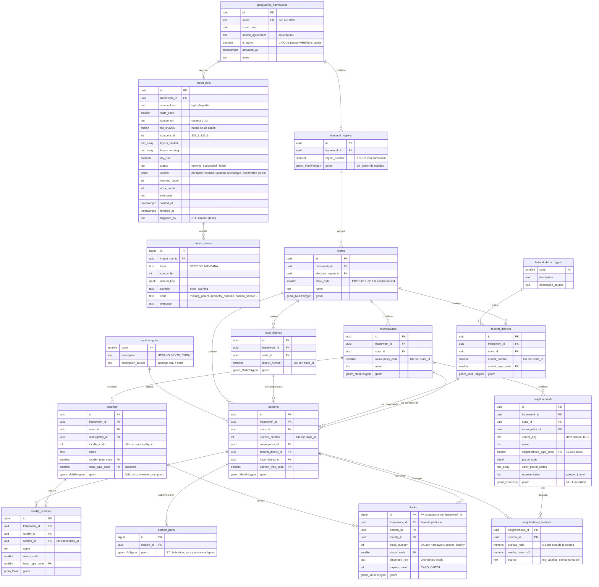
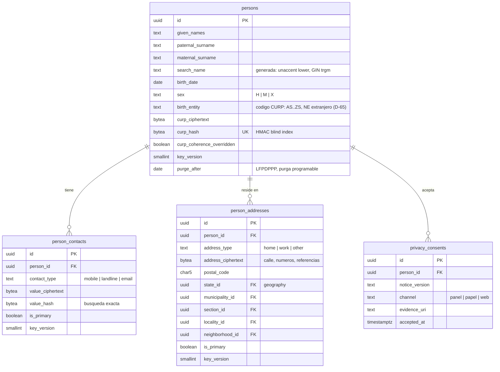
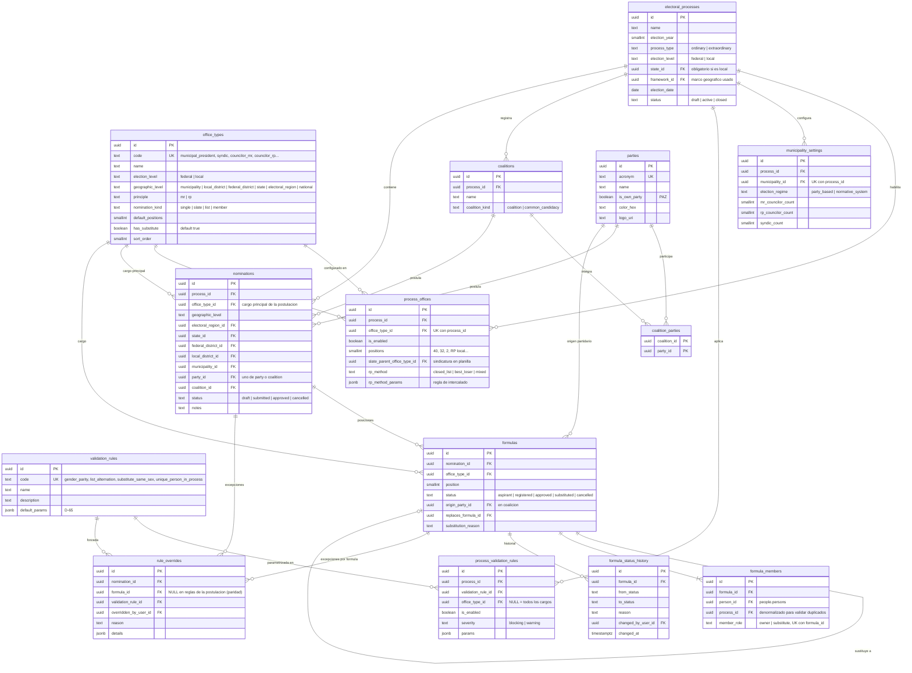
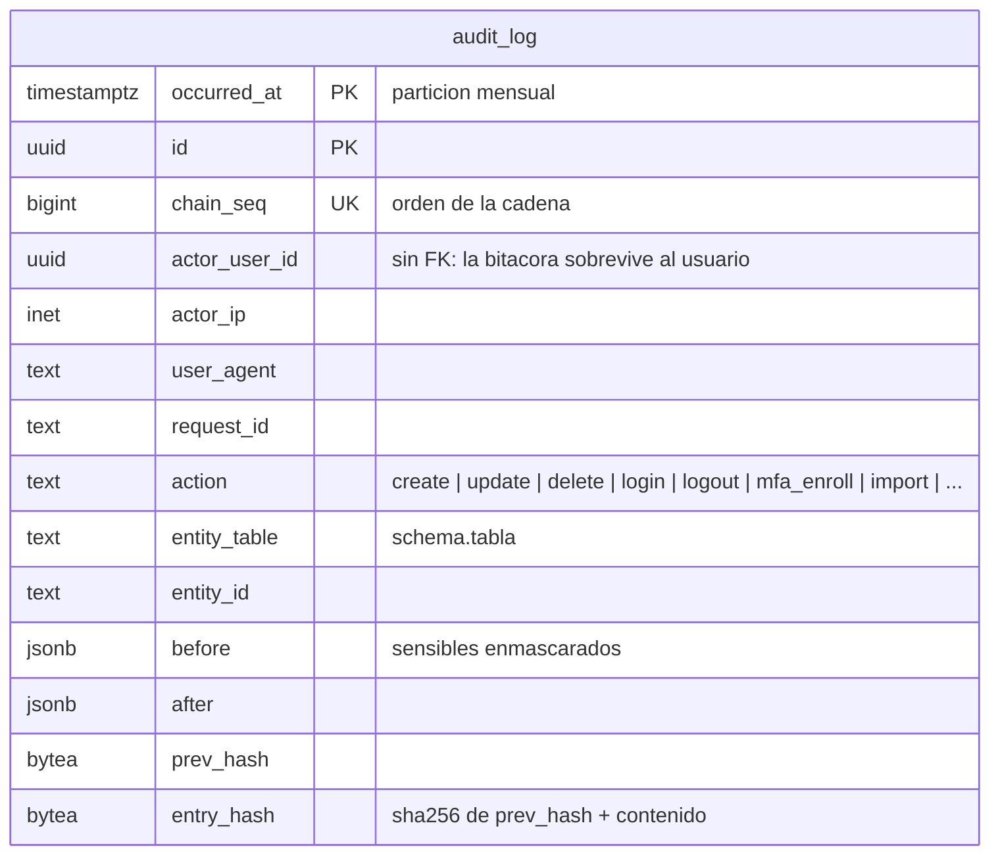
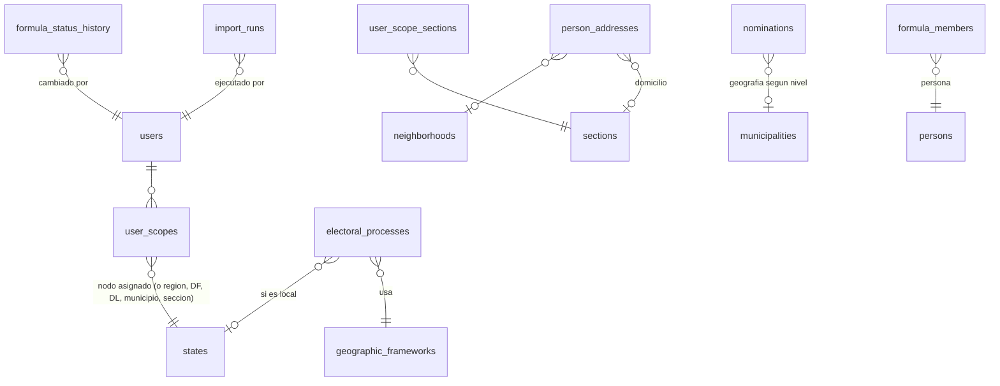

# Modelo de datos — PAZOS MVP

**Estado:** aprobado el 2026-10-24 (D-41). **Base:** `docs/adr/`, el brief original (`docs/history/BRIEF_MVP.md`) y `docs/reference/DISENO_BD_GEOESPACIAL.md`. Antes se llamaba `docs/MODELO_DATOS.md`.

---

## 0. Convenciones

### Esquemas de PostgreSQL (uno por módulo)

| Esquema | Módulo (`app/modules/…`) | Contenido |
|---|---|---|
| `identity` | identity | usuarios, sesiones, 2FA, roles, permisos, alcances |
| `geography` | geography | marcos, geografía electoral y tradicional, importaciones, catálogos de códigos |
| `people` | **people** (nuevo) | persona y sus datos de contacto; base del futuro padrón |
| `candidacies` | candidacies | procesos, configuración electoral, partidos, postulaciones, fórmulas |
| `audit` | core | bitácora inmutable |

> `people` se propone como módulo propio, y no dentro de `candidacies`, porque la persona es la base del futuro padrón y de otros módulos (D-27, CLAUDE.md §Persona).

### Columnas comunes (se omiten en los diagramas)

| Tipo de tabla | Columnas |
|---|---|
| Tablas de negocio (identity, people, candidacies, `geographic_frameworks`) | `created_at`, `updated_at`, `deleted_at` (timestamptz) |
| Tablas geográficas importadas (D-04) | `created_at`, `updated_at`, `import_run_id → import_runs`, `is_active`, `source_id` / `source_control` cuando existan en la BGD |
| `audit.audit_log` (D-37) | solo `occurred_at` |

### Llaves
- PK `uuid` con `DEFAULT uuidv7()`.
- PK `bigint GENERATED ALWAYS AS IDENTITY` en: `blocks`, `locality_sections`, `section_parts`, `import_errors` (D-03).
- Las tablas puente usan PK compuesta.

### Nombres de constraints e índices

| Tipo | Patrón |
|---|---|
| PK | `pk_<tabla>` |
| FK | `fk_<tabla>_<columna>__<tabla_ref>` |
| Único | `uq_<tabla>_<cols>` |
| Índice | `ix_<tabla>_<cols>` |
| Índice GiST | `gx_<tabla>_<col>` |
| Check | `ck_<tabla>_<regla>` |

Se configura con la `naming_convention` del `MetaData` de SQLAlchemy.

### Enumeraciones
Columnas `text` con `CHECK (col IN (...))`, no `ENUM` de PostgreSQL. Agregar un valor es solo cambiar el check en una migración, sin el problema de `ALTER TYPE` dentro de transacciones. (Alternativa: `ENUM` nativo, más compacto pero más rígido.)

### Geometrías
`geometry(<Tipo>, 4326)` con índice GiST. En los diagramas, `geom_MultiPolygon` significa `geometry(MultiPolygon, 4326)`.

### Unicidad con soft-delete
Los `UNIQUE` de tablas de negocio son índices parciales `WHERE deleted_at IS NULL`.

---

## 1. Geografía (`geography`)

**Catálogos de códigos con la misma forma** (`code`, `description`, `description_source`): `section_types`, `federal_district_types`, `block_statuses`, `locality_types`, `locality_head_types`, `neighborhood_types`. Los catálogos de capas fuera del MVP no se crean.

**Notas de geografía**
- **Llaves naturales de upsert (D-02):**

  | Tabla | Llave natural |
  |---|---|
  | `states` | `(framework_id, state_code)` |
  | `municipalities` | `(state_id, municipality_code)` |
  | `sections` | `(state_id, section_number)` |
  | `blocks` | `(framework_id, section_id, locality_id, block_number)` |
  | `neighborhoods` | `(municipality_id, source_key)` |

  Las tablas de nivel inferior se resuelven por la llave natural de su padre.
- **Consistencia de marco:** cada tabla lleva `framework_id` para filtrar el marco activo sin joins. La coherencia hijo-padre se garantiza con FKs compuestas `(framework_id, parent_id) → parent(framework_id, id)`.
- **Punto-en-polígono (< 50 ms p95):** índice GiST sobre `section_parts.geom` → `sections` → municipio, DL y DF por FK → estado → circunscripción. Son 5 joins por PK y un solo lookup espacial.
- **Búsqueda por nombre:** índices GIN `gin_trgm_ops` sobre `unaccent(lower(name))` en municipios, localidades y colonias.
- **Vector tiles:** `ST_AsMVT` sobre `geom` con `ST_SimplifyPreserveTopology` según el zoom. Si las métricas lo piden, se agregan columnas `geom_low` precalculadas en estados, municipios y distritos.
- **Particionado (D-14):** `blocks PARTITION BY LIST (framework_id)`. Por eso la PK es `(framework_id, id)`.

---

## 2. Identidad (`identity`)

```mermaid
erDiagram
    users ||--o| user_invitations : "invitado con"
    users ||--o{ password_reset_tokens : "solicita"
    users ||--o| totp_credentials : "enrola"
    users ||--o{ recovery_codes : "posee"
    users ||--o{ user_sessions : "abre"
    user_sessions ||--o{ refresh_tokens : "rota"
    refresh_tokens ||--o| refresh_tokens : "reemplaza a"
    users ||--o{ user_roles : "tiene"
    roles ||--o{ user_roles : "asignado"
    roles ||--o{ role_permissions : "otorga"
    permissions ||--o{ role_permissions : "incluido"
    users ||--o{ user_scopes : "limitado a"
    users ||--o{ user_scope_sections : "resuelto en"

    users {
        uuid id PK
        citext email UK
        text password_hash "Argon2id"
        text full_name
        text status "invited | active | locked | disabled"
        smallint failed_login_count
        timestamptz locked_until
        timestamptz last_login_at
        timestamptz password_changed_at
    }
    user_invitations {
        uuid id PK
        uuid user_id FK
        bytea token_hash UK
        uuid invited_by_user_id FK
        timestamptz expires_at
        timestamptz accepted_at
        timestamptz revoked_at "D-54"
    }
    password_reset_tokens {
        uuid id PK
        uuid user_id FK
        bytea token_hash UK
        inet requested_ip
        timestamptz expires_at
        timestamptz used_at
    }
    totp_credentials {
        uuid id PK
        uuid user_id FK "UK"
        bytea secret_ciphertext
        smallint key_version
        bigint last_used_step "anti-replay"
        timestamptz confirmed_at
    }
    recovery_codes {
        uuid id PK
        uuid user_id FK
        bytea code_hash
        timestamptz used_at
    }
    user_sessions {
        uuid id PK
        uuid user_id FK
        text device_label
        text user_agent
        inet ip_address
        text_array auth_methods "RFC 8176: pwd, otp (D-54)"
        timestamptz last_seen_at
        timestamptz expires_at
        timestamptz revoked_at
        text revoke_reason
    }
    refresh_tokens {
        uuid id PK
        uuid session_id FK
        bytea token_hash UK
        uuid parent_token_id FK "deteccion de reuso"
        timestamptz expires_at
        timestamptz used_at
        timestamptz revoked_at
    }
    roles {
        uuid id PK
        text code UK "superadmin, admin, coordinator, capturist, viewer"
        text name
        text description
        boolean requires_mfa
        boolean is_system
        boolean grants_all "superadmin (D-54)"
    }
    permissions {
        uuid id PK
        text code UK "candidacies.formula.update"
        text module
        text action "read | create | update | delete | approve | import..."
        text description
    }
    role_permissions {
        uuid role_id PK
        uuid permission_id PK
    }
    user_roles {
        uuid user_id PK
        uuid role_id PK
    }
    user_scopes {
        uuid id PK
        uuid user_id FK
        text scope_level "national | electoral_region | state | federal_district | local_district | municipality | section"
        uuid electoral_region_id FK
        uuid state_id FK
        uuid federal_district_id FK
        uuid local_district_id FK
        uuid municipality_id FK
        uuid section_id FK
    }
    user_scope_sections {
        uuid user_id PK
        uuid section_id PK "derivada, se recalcula"
    }
```

**Notas de identidad**
- **`user_scopes`:** una FK nullable por nivel, con `CHECK` de que solo esté llena la que corresponde a `scope_level`; para `national` todas van vacías. Así hay integridad referencial real, sin FK polimórfica.
- **`user_scope_sections` (D-34):** es una tabla derivada. Se recalcula al cambiar alcances o al activar un marco. Los repositorios filtran con `EXISTS (… user_scope_sections …)`, y "contenida por completo" se evalúa comparando el conjunto de secciones de la postulación contra el del usuario.
- **Nuevo marco geográfico:** los alcances se remapean por llave natural (estado + clave) al nuevo marco dentro del mismo proceso de activación.
- **TOTP:** `requires_mfa` en el rol hace el TOTP obligatorio si cualquiera de los roles del usuario lo exige.
- **WebAuthn:** queda preparado como extensión. Una tabla `webauthn_credentials` se agrega en una fase futura sin tocar las existentes.
- **Rate limiting y revocación:** viven en Redis, no en tablas.

---

## 3. Personas (`people`)

**Notas de personas**
- **Unicidad de CURP:** `uq_persons_curp_hash WHERE deleted_at IS NULL`.
- **Derechos ARCO:** la tabla de solicitudes llega con el módulo de padrón; el diseño ya soporta soft-delete y `purge_after`.
- **Geografía del domicilio:** se guarda en claro (D-31) y se remapea por llave natural al activar un nuevo marco.

---

## 4. Candidaturas (`candidacies`)

### Cómo se representa cada cargo

Cada **postulación** (`nominations`) tiene una geografía y un postulante (partido o coalición). Cada **fórmula** (`formulas`) es una posición dentro de la postulación con su cargo, y **siempre tiene propietario y suplente** (`formula_members`).

| Cargo | Postulación (`office_type` principal, nivel) | Fórmulas |
|---|---|---|
| Planilla municipal | `municipal_president` · municipio | presidencia (1), sindicatura(s) si van en planilla, regidurías MR 1..n, regidurías RP 1..n (los conteos vienen de `municipality_settings`) |
| Sindicatura por separado | `syndic` · municipio | 1..n |
| Alcaldía CDMX | `mayor` · municipio (alcaldía) | alcaldía (1) + concejalías 1..n |
| Diputación local MR | `local_deputy_mr` · DL | 1 |
| Diputación local RP | `local_deputy_rp` · estado | 1..n según `process_offices.positions`; con `best_loser` no se registra lista (D-21) |
| Diputación federal MR | `federal_deputy_mr` · DF | 1 |
| Diputación federal RP | `federal_deputy_rp` · circunscripción | 1..40 |
| Gubernatura | `governor` · estado | 1 |
| Senaduría MR | `senator_mr` · estado | 1..2 (la 1 es la de primera minoría) |
| Senaduría RP | `senator_rp` · nacional | 1..32 |
| Presidencia | `president` · nacional | 1 |

- **Composición de la planilla:** `process_offices.slate_parent_office_type_id` dice qué cargos forman parte de la planilla de otro. Por ejemplo, `syndic → municipal_president` cuando la sindicatura va en planilla, o `NULL` cuando se elige por separado. Agregar un cargo nuevo sigue siendo solo datos, sin migraciones.
- **Geografía de la postulación:** el `CHECK` exige que esté llena exactamente la FK que corresponde a `geographic_level` (ninguna en `national`), y que se cumpla una sola de `party_id` / `coalition_id`.
- **Posición única:** `UNIQUE (nomination_id, office_type_id, position) WHERE status NOT IN ('substituted','cancelled') AND deleted_at IS NULL`. Así, la sustitución (D-29) crea una fórmula nueva en la misma posición sin violar la unicidad.
- **Validaciones:** las reglas del motor (D-28) se evalúan en el servicio. "Persona no duplicada en el proceso" se apoya en el índice `formula_members (process_id, person_id)`, no en un `UNIQUE`, porque la regla es configurable.
- **Marco geográfico:** las FKs geográficas de la postulación pertenecen al `framework_id` del proceso; el servicio lo valida.
- **Vista `nomination_sections`:** `(nomination_id, section_id)` con las secciones que cubre cada postulación; con ella se decide lectura (traslape) y edición (contención) por alcance (D-34, D-65).

---

## 5. Auditoría (`audit`)

- Escribe un rol de BD con solo `INSERT`, con un trigger que rechaza `UPDATE` y `DELETE` (D-37).
- La escritura se hace en la misma transacción que el cambio auditado, desde el servicio, con un hook de unidad de trabajo.
- Las importaciones no escriben por fila: quedan en `geography.import_runs` (D-36), que a su vez genera una entrada `import` en la bitácora.

---

## 6. Vista general entre módulos

---

## 7. Puntos a aprobar

1. **Módulo `people` separado** de `candidacies`.
2. **Enumeraciones como `text + CHECK`** en lugar de `ENUM` nativo.
3. **Postulación + fórmula** como estructura única para todos los cargos (planilla, lista o cargo único), con la composición de planillas configurable mediante `slate_parent_office_type_id`.
4. **`section_parts`** (secciones subdivididas) para cumplir < 50 ms p95 en punto-en-polígono.
5. **`user_scope_sections`** como conjunto derivado para filtrar por alcance en la capa de consulta.
6. **`framework_id` en todas las tablas geográficas** con FKs compuestas para garantizar la coherencia de marco.
7. **Remapeo por llave natural** de alcances y domicilios al activar un nuevo marco.
